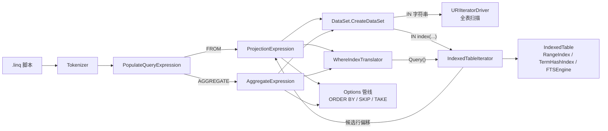

## 用户需求

在现有 VB.NET LINQ 脚本查询引擎（`LINQ.vbproj`）上完成两项增强，并用 `test/data.csv` 做脚本化回归测试。

## 产品概述

一个可脚本化的内存数据查询引擎：脚本以 `FROM ... IN ... WHERE ... SELECT/AGGREGATE ...` 描述查询，引擎解析后执行。本次改造让引擎不再对数据做逐行遍历扫描，而是通过脚本中 `index(...)` 函数创建"带索引的数据源对象"，利用已有索引技术（数值范围索引、词项哈希索引、全文索引、Levenshtein 索引）完成过滤、分组与排序；同时让解释器支持聚合查询。

## 核心功能

1. 索引数据源：脚本中可用 `index("data.csv", terms = ["Pol.", "Scan"], range = ["CalcMz","PeakQuality","m-Score"], fulltext = ["LipidIon"])` 作为 `IN` 的数据源，返回带索引的表对象；字段名不存在时给出明确错误。
2. 索引加速过滤：`WHERE x.PeakQuality >= 0.999` 这类条件自动翻译成索引查询（范围/等值/词项），先用索引得到候选行偏移，再对候选行做条件复核，结果必须与全表扫描完全一致；无法命中索引时自动回退全表扫描。
3. WHERE 逻辑运算：支持 `and` / `or` / `not`（当前会抛 NotImplementedException），并让多个索引条件按 `and` 取交集；`or`/`not` 场景下不做索引收窄（保证不丢结果）。
4. 索引加速分组与排序：`GROUP BY` 在索引候选集上分组，分组字段有词项哈希索引时复用索引的分组信息；排序字段有数值索引且排序键为源字段列名时按索引键顺序取行，其余情况按现有管线排序。
5. 聚合查询：新增 `AGGREGATE ... INTO ...` 脚本语法，支持 `count / sum / avg / min / max / first / last`；支持 `GROUP BY`（每组输出一行），也支持不分组（输出单行）；聚合结果可继续 `ORDER BY / SKIP / TAKE`。
6. 兼容与健壮性：现有 `query.linq`、`cdf.linq`、`sqlite*.linq` 脚本行为不变；索引过滤后结果为空时管线不再抛异常；`QueryInterpreter` 与 CLI 同时支持 SELECT 与 AGGREGATE 表达式。
7. 测试交付：新增聚合测试脚本；新增测试项目对 `data.csv` 执行 `query.linq`、`query_index.linq`、聚合脚本，校验二者结果等价、索引确实命中、聚合数值正确，并使用 DebugAudit 生成测试报告。

## 技术选型

- 语言/运行时：沿用项目现有 **VB.NET / net10.0**（`dotnet` SDK 11.0.100，已安装 `Microsoft.NETCore.App 10.0.15` 运行时，可构建运行）。
- 依赖：复用现有 `sciBASIC#`（`Core.vbproj`、`dataframework-netcore5.vbproj`）与 `LINQ.vbproj` 内部已有的索引实现（`RangeIndex`、`TermHashIndex`、`LevenshteinIndex`、`FTSEngine`），**不新增第三方依赖、不改动 sciBASIC# 代码**。
- 测试：新增独立控制台测试项目，使用 `Microsoft.VisualBasic.ApplicationServices.Debugging.DebugAudit`（`Check/AreEqual/Snapshot/Mark/SaveReport`）生成测试报告。

## 实现思路

### 总体策略

解释器侧新增"索引数据源"分支：`IN index(...)` 求值为一个索引规格描述对象，`DataSet.CreateDataSet` 据此构造 `IndexedTableIterator`，其内部持有由 DataFrame 构建的 `IndexedTable`（封装现有 `MemoryIndex`/`MemoryQuery` 索引族）。执行 `WHERE` 前先把条件表达式静态翻译成 `LINQ.Query()` 列表，交给索引得到**候选行偏移**；随后仍按原有逻辑对候选行逐行复核条件。索引只做"缩小候选集"，不替代条件求值，从而保证"索引路径结果 ≡ 全表扫描结果"这一硬约束。

### 关键决策与权衡

1. **索引只做收窄 + 条件复核**：`RangeIndex` 的边界与 `TermHashIndex` 的 LCase 归一化都可能与扫描语义有细微差异（如 `data.csv` 中空单元格在扫描路径是 `Nothing`、在字符串转换路径是 `""`/`0`）。采用"收窄 + 复核"可完全规避假阴性，代价是被收窄后仍需一次轻量的逐行判断（从 O(N) 表达式求值降为 O(k)）。索引键值直接取"与扫描路径相同的类型化行对象"（`DataFrameResolver.EnumerateRowObjects` + `Headers` 列类型），进一步减少不一致。
2. **`Query.strict` 修正**：现有 `ValueMatchSearch` 对 `>`/`<` 硬编码 `strict:=True`，若用于 `>=`/`<=` 会丢边界行（假阴性）。为 `LINQ.Query` 增加 `strict` 属性（默认 `True` 保持旧行为），由翻译器按运算符设置。
3. **三态索引结果**：现有 `MemoryQuery.GetIndex` 用 `Nothing` 同时表示"未使用索引"和"无命中"，不可用。新增 `IndexQueryResult { Used, Addresses }`，`TryGetIndex` 返回三态；`GetIndex` 保留原签名委托实现，避免影响 `MemoryTable`/`MemoryPool` 既有调用方。
4. **`index(...)` 必须用专用表达式类型**：`FuncEval` 走 `Callable.Evaluate` 且不支持命名参数，`terms = [...]` 会被当作等值比较求值成 Boolean。因此在 `SyntaxImplements.ParseExpression` 的 `funcName + (...)` 分支特判 `index`，用 token 级 `SplitParameters` 解析"位置参数（路径）+ 命名参数（索引规格）"，构造 `IndexSource` 表达式。
5. **聚合用专用执行器而非内置函数表**：`Callable.Evaluate` 只接受标量参数，无法表达"对整列聚合"。`AggregateExpression` 自行解析 `INTO` 中的每个字段表达式（必须是 `name = aggFunc(args)` 形式），对每个分组/行集迭代累加；`count/sum/avg/min/max/first/last` 以枚举 + 累加器实现，未知名报明确异常。
6. **排序优化保持保守**：`ORDER BY` 在现有架构中作用于**投影后的输出对象**（`OrderBy` 依赖输出列名建符号）。仅在"排序键是源字段的裸列名、该字段有数值索引、且该列名出现在投影输出中、且 `ORDER BY` 是管线第一阶段"时才按索引键顺序取行并跳过该阶段；其余情况维持原逻辑，避免 `SKIP` 早于 `ORDER BY` 时的语义错乱（`query.linq` 即为 `SKIP → ORDER BY → TAKE`，不触发下推）。
7. **向后兼容**：不改 `MemoryTable`/`MemoryPool` 现有公共签名；`ProjectionExpression` 的逐行复核逻辑保留；`QueryInterpreter`/`Program` 仅把 `ProjectionExpression` 变量类型放宽为 `QueryExpression`。

### 性能与可靠性

- 索引构建：范围索引 O(n log n)（内部排序）、词项哈希 O(n)、全文索引 O(总文本量)，均为一次性成本；`index(...)` 只对脚本显式列出的字段建索引，避免无脑全列建索引。
- 查询：范围检索 O(log n + k)、词项检索 O(1) 查表 + O(k)、多条件 `and` 走偏移集合交集；全表扫描的 N 次表达式求值降为 k 次（k 为候选行数）。
- 内存：`IndexedTable` 复用 `DataFrameResolver` 的行对象，不重复解析 CSV；仅在需要时物化列向量。
- 可靠性：索引不可用/字段不存在/索引类型不匹配时**降级为扫描并继续**（字段名不存在于数据源则报错）；聚合参数为 `Nothing` 的行按 SQL 语义跳过（`count` 统计行）。
- 错误处理：新增 `MissingPrimaryKeyException`（缺字段/缺索引实现）、`SyntaxErrorException`（缺少 `INTO`、非法聚合函数）并附带脚本位置信息性描述。

## 架构设计



- 分层保持不变：`Language`（词法）→ `Script`（语法构建）→ `Interpreter.Expressions`（表达式）→ `Interpreter.Query`（查询执行/数据源）→ `MemoryQuery` + `Runtime.Indexing`（索引）。
- 新增职责单一的小类：`IndexSource`（脚本层表达式）、`IndexTableSource`（索引规格描述）、`IndexedTableIterator`（数据集适配）、`IndexedTable`（索引持有与检索）、`WhereIndexTranslator`（条件→索引查询）、`GroupBy`/`AggregateInto`/`NotExpression`/`AggregateFunction`（聚合构件）。

## 目录结构（仅列新增/修改）

```
src/data/LINQ/
├── LINQ/
│   ├── Interpreter/
│   │   ├── Expressions/
│   │   │   ├── IndexSource.vb                    # [新增] index(...) 表达式：解析路径与 terms/range/fulltext/levenshtein 规格，Exec 返回 IndexTableSource 描述对象
│   │   │   ├── NotExpression.vb                  # [新增] 一元 not 求值（Nothing 视为 False）
│   │   │   ├── BinaryExpression.vb               # [修改] 实现 and/or 求值（短路），暴露 Operator 供索引翻译使用
│   │   │   └── Keywords/
│   │   │       ├── GroupBy.vb                    # [新增] GROUP BY 子句：NamedValue(Of Expression)() 分组键（支持别名），Exec 求值单行键
│   │   │       ├── AggregateInto.vb              # [新增] INTO 投影：NamedValue(Of Expression)() 聚合字段，负责校验聚合函数名
│   │   │       ├── WhereFilter.vb                # [修改] 新增 GetIndexQuery(symbol) 把条件翻译并缓存为 LINQ.Query()（不可索引返回 Nothing）
│   │   │       └── Options/OrderBy.vb            # [修改] 暴露 SortName / IsDescending，供排序下推守卫判断
│   │   ├── Query/
│   │   │   ├── ProjectionExpression.vb           # [修改] 用 dataset.TryQuery(索引条件) 取候选行、保留逐行复核、支持索引序跳过 ORDER BY 阶段
│   │   │   ├── AggregateExpression.vb            # [修改] 实现聚合执行：候选行收窄 → WHERE 复核 → 分组 → 累加 → 输出 JavaScriptObject() → 管线
│   │   │   ├── Options.vb                        # [修改] 空结果保护（raw.Length=0 直接返回空）
│   │   │   ├── IndexTableSource.vb               # [新增] 索引规格描述（Uri + Terms/Ranges/FullText/Levenshtein 字段集）
│   │   │   ├── WhereIndexTranslator.vb           # [新增] 表达式→LINQ.Query() 翻译：> >= < <= = 可索引，and 合并，or/not/<> 放弃收窄
│   │   │   └── DataSoruce/
│   │   │       ├── DataSoruce.vb                 # [修改] 新增 TryQuery 虚方法；CreateDataSet 识别 IndexTableSource 分支
│   │   │       └── IndexedTableIterator.vb       # [新增] 索引数据集：解析驱动、构建 IndexedTable、按偏移产出 JavaScriptObject、暴露分组与排序偏移
│   │   ├── Script/
│   │   │   ├── SyntaxImplements.vb               # [修改] 特判 index(...) ；CreateAggregateQuery 解析 IN/WHERE/GROUP BY/INTO/管线；ParseKeywordExpression 增加 group/into 分支；抽取 GetProjectionFields 复用
│   │   │   └── Builders/BinaryBuilder.vb         # [修改] orders 增加比较运算符优先级层、识别一元 not
│   │   ├── QueryInterpreter.vb                   # [修改] 查询变量类型放宽为 QueryExpression，结果转 JavaScriptObject()
│   │   └── Program.vb                            # [修改] CLI 同步放宽类型，使聚合脚本可输出表格/CSV
│   ├── MemoryQuery/
│   │   ├── IndexedTable.vb                       # [新增] 可索引表：从 DataFrameResolver 或对象行构建；按规格建 RangeIndex/TermHashIndex/FTSEngine/LevenshteinIndex；TrySelect（三态偏移）、GetGroups、OrderedOffsets、统计信息
│   │   ├── MemoryQuery.vb                        # [修改] 新增 TryGetIndex(filter) As IndexQueryResult（三态），GetIndex 委托保持兼容；ValueMatchSearch 使用 Query.strict
│   │   └── Query.vb                              # [修改] 增加 strict As Boolean = True 属性
│   └── Runtime/
│       ├── Drivers/DataFrameDriver.vb            # [修改] 暴露 LoadTable(uri) As DataFrameResolver（缓存 + MeasureTypeSchema），ReadFromUri 复用
│       └── Indexing/RangeIndex.vb                # [修改] 新增 OrderedAddresses(desc) 按索引键顺序枚举原始行偏移（块内保持插入顺序，稳定）
├── test/
│   ├── query_aggregate.linq                      # [新增] 全局聚合示例（count/sum/avg/min/max）
│   ├── query_aggregate_group.linq                # [新增] GROUP BY x.Class + INTO + ORDER BY 示例
│   ├── query_aggregate_index.linq                # [新增] index(...) + WHERE + GROUP BY + INTO 组合示例
│   └── LinqQueryTest/
│       ├── LinqQueryTest.vbproj                  # [新增] 独立 net10.0 控制台测试项目，引用 LINQ.vbproj/Core/DataFrame
│       └── Program.vb                            # [新增] 用 DebugAudit 执行脚本审计：等价性、索引命中、聚合数值、and/or/not；SaveReport 输出报告
```

## 关键结构（仅接口层）

```
Namespace Interpreter.Query

    Public Class IndexQueryResult
        ''' <summary>索引是否被真正使用（False 时调用方必须回退全表扫描）</summary>
        Public Property Used As Boolean
        ''' <summary>候选行偏移，空数组表示索引判定“无命中”</summary>
        Public Property Addresses As Integer()
    End Class

    Public MustInherit Class DataSet
        Public MustOverride Function PopulatesData() As IEnumerable(Of Object)
        ''' <summary>
        ''' 返回 Nothing：当前数据源不支持索引或条件不可索引，调用方回退扫描
        ''' </summary>
        Public Overridable Function TryQuery(filter As IEnumerable(Of Query)) As IndexQueryResult
            Return Nothing
        End Function
    End Class

End Namespace
```

```
''' <summary>可索引的内存表：过滤、分组、排序的数据基础</summary>
Public Class IndexedTable : Inherits MemoryIndex

    Sub New(df As DataFrameResolver, spec As IndexTableSource)
    ''' <summary>按规格建索引，返回无法建立的字段说明（用于降级而不是中断）</summary>
    Public Function BuildIndexes() As String()
    ''' <summary>三态检索：Used=False 表示未使用索引</summary>
    Public Function TrySelect(filter As IEnumerable(Of Query)) As IndexQueryResult
    ''' <summary>分组字段的词项索引分组（键 -> 行偏移），无索引返回 Nothing</summary>
    Public Function TryGetGroups(field As String) As Dictionary(Of String, Integer())
    ''' <summary>数值索引键顺序的行偏移（无索引返回 Nothing）</summary>
    Public Function TryGetOrdered(field As String, descending As Boolean) As Integer()
    Public ReadOnly Property TotalRows As Integer
End Class
```

## 执行注意事项

- 修改 `MemoryQuery.GetIndex` 之外的公共签名时，先搜索调用点（`MemoryTable.Query`、`MemoryPool.Query`）确认兼容；`GetIndex` 语义保持不变。
- `data.csv` 的 `PeakQuality` 存在空单元格：索引键必须来自 `EnumerateRowObjects` 的类型化值（`Nothing` → 数值 0/字符串 ""），并在使用前完成 `MeasureTypeSchema`。
- `ORDER BY` 下推必须同时满足：`SortName` 是源字段、该字段有数值索引、该名字出现在投影输出列中、`ORDER BY` 是管线第一段；否则走原逻辑。
- 结果为空时 `Options.RunOptionPipeline` 直接返回空集合，避免 `raw(Scan0)` 越界。
- 不改动 `sciBASIC#` 下任何文件；不引入日志框架，错误通过既有 `App.LogException`/异常消息表达，避免每次查询刷日志。